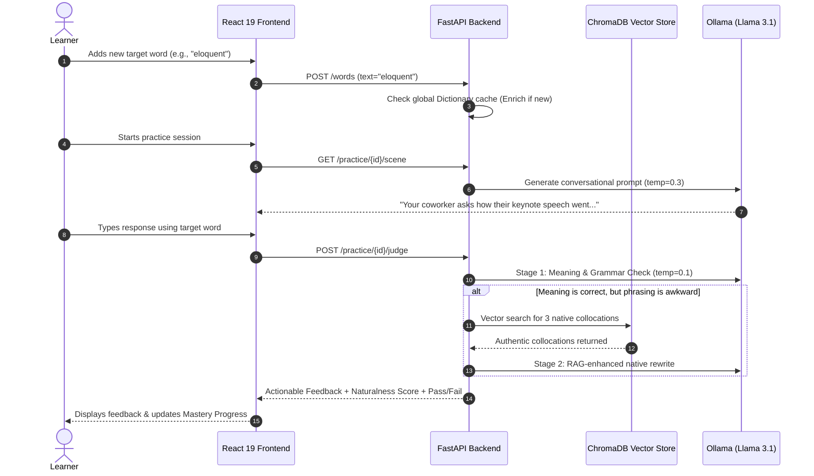

<div align="center">

#  UsedIt

### **Stop memorizing words in isolation. Start using them in context.**

An intelligent, local-first vocabulary mastery platform powered by **Local LLMs (Ollama + Llama 3.1)** and **Vector Search (ChromaDB)**.

[](https://fastapi.tiangolo.com)
[](https://react.dev)
[](https://tailwindcss.com)
[](https://www.trychroma.com/)
[](https://ollama.com)
[](./LICENSE)
[](#-100-local-private--zero-cost)

<br/>

[English Readme](#-the-problem-with-vocabulary-learning) • [快速中文指南 (Quickstart CN)](./docs/QUICKSTART_CN.md) • [Backend & AI Deep Dive](./docs/BACKEND_AND_AI_TECH.md) • [后端深度解析 (CN)](./docs/BACKEND_AND_AI_TECH_CN.md) • [Changelog](./CHANGELOG.md) • [Contributing](./CONTRIBUTING.md)

</div>

---

## 💡 The Problem with Vocabulary Learning

Most language learners fall into the **"Passive Vocabulary Trap"**:

```
      Traditional Flashcards                     UsedIt Active Output
   ┌───────────────────────────┐             ┌───────────────────────────┐
   │ Word: "Eloquent"          │             │ Conversational Scenario:  │
   │ Definition: fluent, apt   │             │ "Your coworker asks how   │
   │                           │             │ their keynote speech went"│
   │ [Press 'Good' / 'Again']  │             │                           │
   └─────────────┬─────────────┘             └─────────────┬─────────────┘
                 ▼                                         ▼
   ❌ Passive Recognition Only                 ✅ Active Production
   "I know what it means when                  "I can deploy this word
    I see it on paper."                         naturally in conversation."
```

* **Rote memorization doesn't translate to production:** You can flip through 1,000 Anki flashcards and still freeze when writing an email or speaking in an interview.
* **Isolated example sentences are forgettable:** Fixed dictionary sentences lack emotional resonance or contextual urgency.
* **No feedback loop for your own sentences:** If you try making up your own sentence, nobody is there to tell you whether your word choice was awkward, grammatically flawed, or unnatural.

**UsedIt fixes this by turning vocabulary study into a conversational simulation with a tireless, native-speaking AI mentor.**

---

## ✨ Key Features & Technical Highlights

### 🎭 Dynamic Context Generation
No static, repetitive fill-in-the-blanks. When you practice a word, UsedIt dynamically generates an authentic social scenario where someone (a manager, coworker, friend, doctor, or interviewer) speaks directly to you, prompting you to reply using the target word.

### 🧠 Dual-Model Temperature Separation
A single temperature parameter cannot satisfy both creative role-playing and objective grading:
* **Creative Generator (`temperature = 0.3`)**: Crafts diverse, socially realistic conversational scenes.
* **Deterministic Judge (`temperature = 0.1`)**: Evaluates syntax, core semantics, and naturalness with minimal variance across sessions.

### 📚 RAG-Grounded Collocations (ChromaDB)
Powered by an embedded vector database populated with authentic sentences from real-world corpuses. If your sentence is grammatically sound but phrasing feels awkward (`Slightly Off`), ChromaDB retrieves native collocations and guides the LLM to rewrite a natural alternative tailored to your scene.

### ⚖️ Adaptive Strictness Tiers
Tailor the grading rubric to your proficiency level:
* **Lenient**: Focuses strictly on semantic comprehension. Forgives minor slips in grammar or preposition choice.
* **Normal**: Balanced standard. Passes if meaning is accurate and phrasing sounds natural or only slightly off.
* **Strict**: Native-speaker bar. Requires accurate syntax and completely fluent, idiomatic phrasing.

### 🔒 100% Local, Private & Zero-Cost
Runs entirely on your machine via **Ollama (`llama3.1:8b`)**.
* 🚫 No OpenAI / Anthropic API keys required
* 🚫 No recurring subscription fees
* 🔒 Your personal vocabulary history and practice attempts never leave your computer

### 📖 Automatic Multi-Dimensional Word Enrichment
Adding a single word triggers automatic enrichment:
* IPA Phonetic transcription & audio pronunciation links
* Part of speech & CEFR difficulty rating (`Easy`, `Medium`, `Hard`)
* Detailed English definitions & memory aids (mnemonics)
* Etymology, emotional tone, synonyms, and antonyms
* Real-world collocations from ChromaDB

### 🎨 Minimalist Editorial Design
Crafted with typographic discipline inspired by classic print editorial design, built with **React 19** and **Tailwind CSS v4** for fluid micro-interactions and distraction-free learning.

---

## 🥊 Comparison: How UsedIt Stands Out

| Feature | Traditional Flashcards (Anki / Quizlet) | Gamified Apps (Duolingo) | Generic ChatGPT Prompts | **UsedIt** |
| :--- | :---: | :---: | :---: | :---: |
| **Learning Paradigm** | Passive Recognition | Fixed Multiple Choice | Freeform Chat | **Active Contextual Output** |
| **Scenario Variety** | Static / None | Scripted & Repetitive | Variable (Unstructured) | **Dynamic, Persona-Driven** |
| **Evaluation Rubric** | Self-rated (Honesty system) | Binary string match | Vague / Overly flattering | **Cascaded (Meaning + Naturalness)** |
| **Collocation Grounding**| None | Static | Hallucination-prone | **RAG-Grounded (ChromaDB)** |
| **Privacy & Cost** | Free & Local | Subscription / Ads | API Token Charges | **100% Free & Local (Ollama)** |
| **Structured Progress** | Spaced Repetition Only | Gamified XP | None (Transient chat) | **Mastery Metrics + Practice Logs** |

---

## 🔄 How It Works (The 4-Step Learning Cycle)



---

## 🏛️ System Architecture

UsedIt uses a decoupled two-tier architecture that optimizes storage, speed, and privacy:

```text
UsedIt/
├── .github/                  # Issue & PR community templates
├── frontend/                 # React 19 + Tailwind CSS v4 + Vite SPA
│   ├── src/
│   │   ├── components/       # Editorial navigation, status badges, page layouts
│   │   ├── pages/            # WordLibrary, WordDetail, PracticeSession, Progress
│   │   └── lib/              # API client & localStorage state management
│   ├── .env.example          # Frontend environment variables template
│   └── package.json
├── backend/                  # FastAPI + SQLModel + ChromaDB Python Services
│   ├── app/                  # Application core (routers, models, database, auth)
│   ├── tests/                # Automated API & bias calibration test suite
│   ├── scripts/              # Corpus ingestion & ChromaDB maintenance utilities
│   ├── data/                 # Embedded SQLite (dev.db) & ChromaDB vector store
│   ├── .env.example          # Backend environment variables template
│   └── requirements.txt
├── docs/                     # Deep-dive technical documentation
│   ├── BACKEND_AND_AI_TECH.md    # English: Vector DB, RAG & LLM engineering deep dive
│   ├── BACKEND_AND_AI_TECH_CN.md # 中文: 向量数据库与大模型工程技术深度解析
│   └── QUICKSTART_CN.md          # 中文: 详细运行与环境排错指南
├── CONTRIBUTING.md            # Contributor guidelines
├── CODE_OF_CONDUCT.md         # Community code of conduct
├── SECURITY.md                # Security policy & responsible disclosure
├── CHANGELOG.md               # Version release history
└── LICENSE                    # MIT open-source license
```

### Relational Schema Design
Instead of duplicating dictionary entries per user, UsedIt isolates learning progress from global word metadata:
* **`Dictionary` (Global Cache)**: Full linguistic data (phonetics, definitions, etymology, difficulty) enriched once and shared across all users.
* **`UserWord` (Per-User Status)**: Tracks individual learning status (`NEW` ➔ `PRACTICING` ➔ `MASTERED`).
* **`PracticeSession` (Historical Log)**: Archives every contextual scene, user input, AI judgment, and consecutive pass count.

---

## 🧭 Services & Port Matrix

| Service | Technology | Port / Path | Standalone Start? | How It Runs |
| :--- | :--- | :--- | :---: | :--- |
| **Backend API** | FastAPI (Python) | `http://localhost:8000` | **Yes** | `uvicorn app.main:app --reload --port 8000` |
| **Relational DB** | SQLite (SQLModel) | `backend/data/dev.db` | ❌ **No** | Auto-created on backend startup (`lifespan`) |
| **Vector DB** | ChromaDB | `backend/data/chroma_db/` | ❌ **No** | Embedded Python library; runs within FastAPI |
| **Local LLM** | Ollama (`llama3.1:8b`) | `http://localhost:11434` | **Yes** | `ollama run llama3.1:8b` |
| **Frontend Web** | React 19 + Vite | `http://localhost:5173` | **Yes** | `cd frontend && npm run dev` |

---

## 🚀 Quick Start Guide

### Prerequisites
1. **Python 3.10+**
2. **Node.js 18+** & **npm**
3. **[Ollama](https://ollama.com/)** installed on your system

---

### Step 1: Start the Local LLM (Ollama)

Open your terminal and load the default Llama 3.1 8B model:
```bash
ollama run llama3.1:8b
```
*(Leave this running or ensure the Ollama background daemon is active).*

---

### Step 2: Set Up and Start the Backend

Open a new terminal window:

```bash
cd backend

# 1. Create and activate a Python virtual environment
python3 -m venv venv
source venv/bin/activate       # On Windows use: .\venv\Scripts\Activate.ps1

# 2. Install dependencies
pip install -r requirements.txt

# 3. Configure environment variables
cp .env.example .env

# 4. Start the FastAPI development server
uvicorn app.main:app --reload --port 8000
```

> **Database Note**: You **do not** need to install or configure MySQL/PostgreSQL. The SQLite database (`dev.db`) and ChromaDB vector index are automatically initialized on startup!

Verify the backend is live:
* **Health Check**: Open [http://localhost:8000/](http://localhost:8000/) (returns `{"message": "UsedIt API is running"}`)
* **Interactive API Docs (Swagger UI)**: Open [http://localhost:8000/docs](http://localhost:8000/docs)

---

### Step 3: Set Up and Start the Frontend

Open another terminal window:

```bash
cd frontend

# 1. Configure environment variables
cp .env.example .env

# 2. Install dependencies
npm install

# 3. Start the Vite dev server
npm run dev
```

Open your browser at:
👉 **[http://localhost:5173](http://localhost:5173)**

---

### Step 4: Start Practicing Immediately!

Open your browser at:
👉 **[http://localhost:5173](http://localhost:5173)**

UsedIt launches directly into your Word Library in **Frictionless Local-First Mode**. No sign-up, passwords, or cloud credentials required — immediately add vocabulary, launch conversational AI role-plays, and track your active mastery!

---

## 📡 Core API Reference

Interactive API documentation with request execution is accessible at **[http://localhost:8000/docs](http://localhost:8000/docs)**.

| Endpoint | Method | Auth | Description |
| :--- | :---: | :---: | :--- |
| `/auth/register` | `POST` | Public | Register a new username and password |
| `/auth/login` | `POST` | Public | Authenticate and obtain JWT Bearer Token |
| `/auth/me` | `GET` | Bearer | Get current user's profile and strictness preferences |
| `/auth/me` | `PATCH` | Bearer | Update user strictness (`Lenient`, `Normal`, `Strict`) |
| `/words` | `GET` | Bearer | Paginated vocabulary list with status filters (`NEW`, `PRACTICING`, `MASTERED`) |
| `/words` | `POST` | Bearer | Add word to user library (triggers automatic dictionary enrichment) |
| `/words/stats` | `GET` | Bearer | Aggregate count of mastered, practicing, and new words |
| `/words/{id}` | `GET` | Bearer | Full word metadata, ChromaDB collocations, and practice history |
| `/words/{id}` | `DELETE`| Bearer | Remove word from user library (preserves shared dictionary) |
| `/practice/{id}/scene` | `GET` | Bearer | Generate a realistic contextual prompt using LLM (`temp=0.3`) |
| `/practice/{id}/judge` | `POST` | Bearer | Evaluate sentence meaning, grammar, and naturalness with RAG rewrite |
| `/sessions` | `GET` | Bearer | List practice history sessions for the authenticated user |
| `/sessions/stats` | `GET` | Bearer | Aggregate practice statistics (total sessions, accuracy rate) |

---

## 🛠️ Data Management & Maintenance

* **Reset Database**:
  To clear all user data and start fresh, simply remove `backend/data/dev.db` while the backend is stopped:
  ```bash
  rm backend/data/dev.db
  ```
  Restarting the backend will re-create clean tables automatically.
* **Vector Database Maintenance**:
  Run from the `backend/` directory using the virtual environment:
  ```bash
  # Inspect documents stored in ChromaDB
  ./venv/bin/python scripts/read_chromadb.py

  # Test vector initialization and dummy embeddings
  ./venv/bin/python scripts/setup_chroma.py

  # Ingest and embed vocabulary examples from raw TSV corpus
  ./venv/bin/python scripts/automation_pipeline.py
  ```

---

## 🗺️ Roadmap & Future Improvements

- [ ] **Docker Compose:** One-click `docker compose up` setup with pre-packaged Ollama models.
- [ ] **Spaced Repetition System (SRS):** Integrate FSRS / SM-2 scheduling for optimal practice timing.
- [ ] **Speech-to-Text Input:** Voice input support via Web Speech API or local Whisper model.
- [ ] **Anki & CSV Import/Export:** Seamlessly import existing vocabulary decks from Anki.
- [ ] **React Query Integration:** Frontend state management and caching via `@tanstack/react-query`.
- [ ] **Comprehensive Test Suite:** Backend unit tests (`pytest`) and frontend component tests (`vitest`).

---

## 🤝 Contributing

Contributions make the open-source community an incredible place to learn, inspire, and create. Any contributions you make are **greatly appreciated**!

Please check our [**Contributing Guidelines (CONTRIBUTING.md)**](./CONTRIBUTING.md) and [**Code of Conduct (CODE_OF_CONDUCT.md)**](./CODE_OF_CONDUCT.md) for details on development setup, code style, and how to submit pull requests.

1. Fork the Project
2. Create your Feature Branch (`git checkout -b feature/AmazingFeature`)
3. Commit your Changes (`git commit -m 'feat: add some AmazingFeature'`)
4. Push to the Branch (`git push origin feature/AmazingFeature`)
5. Open a Pull Request

---

## 🔒 Security

For responsible vulnerability disclosure and local AI data privacy details, please refer to our [Security Policy (SECURITY.md)](./SECURITY.md).

---

## 📄 License

Distributed under the **MIT License**. See [`LICENSE`](./LICENSE) for more information.

---

<div align="center">
  <b>Built with ❤️ for learners who want to speak with confidence.</b><br/>
  <sub>If you find UsedIt helpful, please consider giving it a ⭐ on GitHub!</sub>
</div>
